<p align="center"></p>

<h1 align="center">Quick Diary</h1>

<p align="center">Encrypted Markdown notes for iPhone and iPad, in a folder you choose.<br>
SwiftUI · iOS 17+ · no servers, no accounts, no analytics.</p>

## Gallery

| Locked | Notes | Editor bar | Insert menu |
|:-:|:-:|:-:|:-:|
| 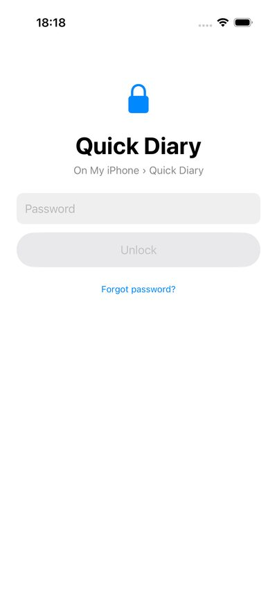 | 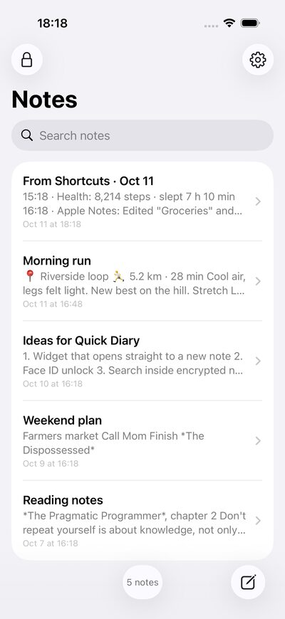 | 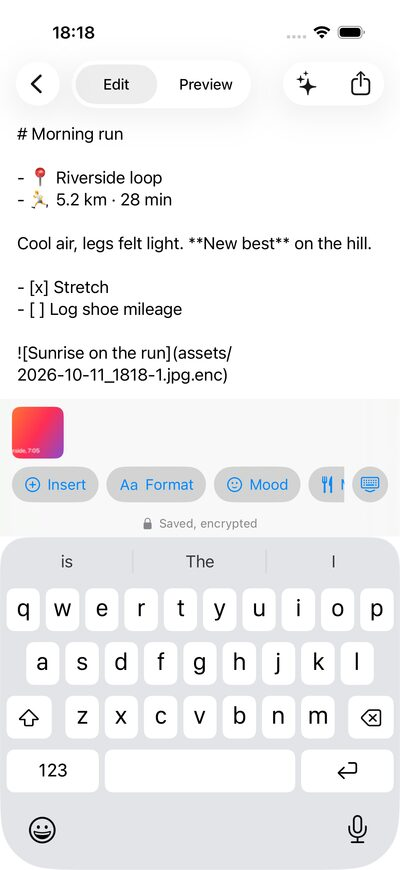 | 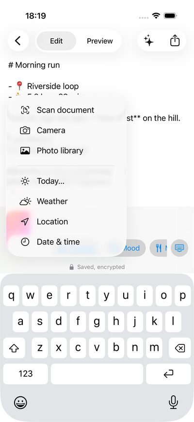 |
| **Preview** | **Quick entry** | **Today** | **AI summary** |
| 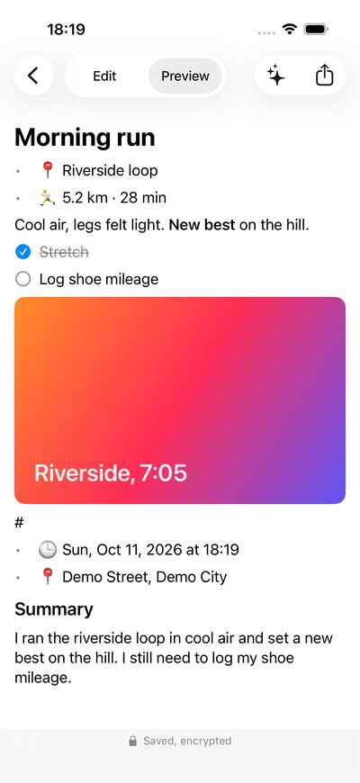 | 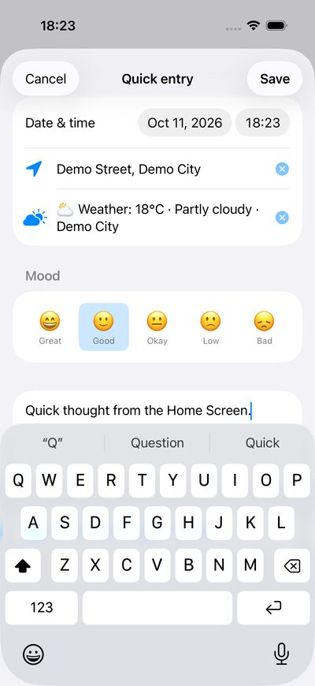 | 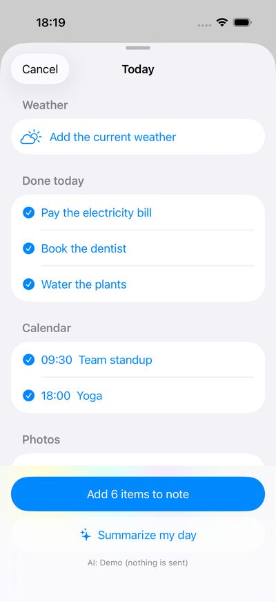 | 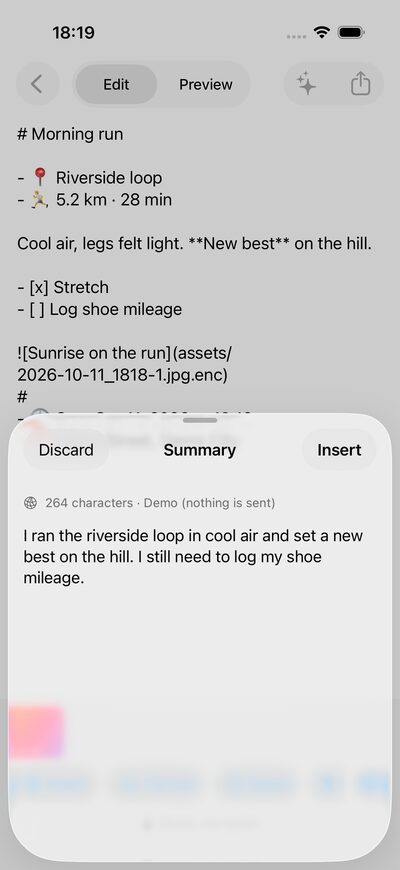 |
| **Settings** | **Backup** | **Recently Deleted** | **Dark, large text** |
| 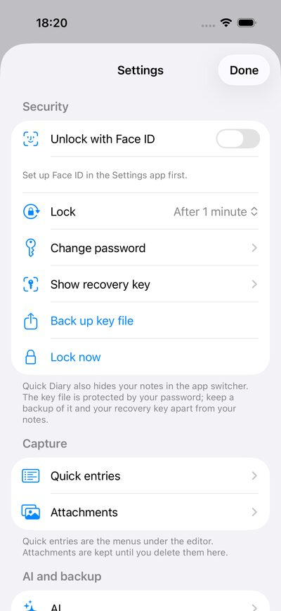 | 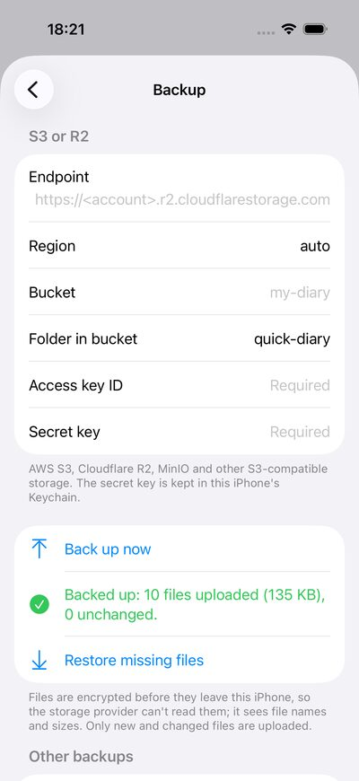 | 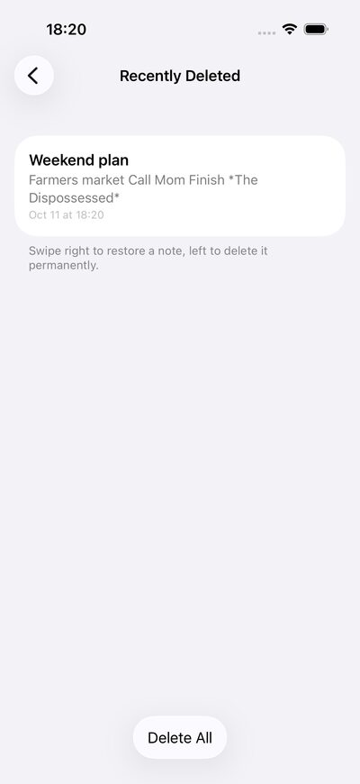 | 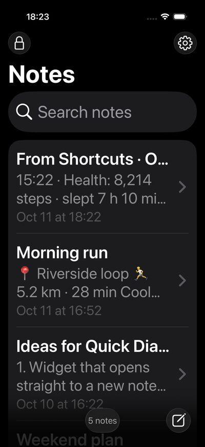 |

On iPad, the list and the editor sit side by side:

<p>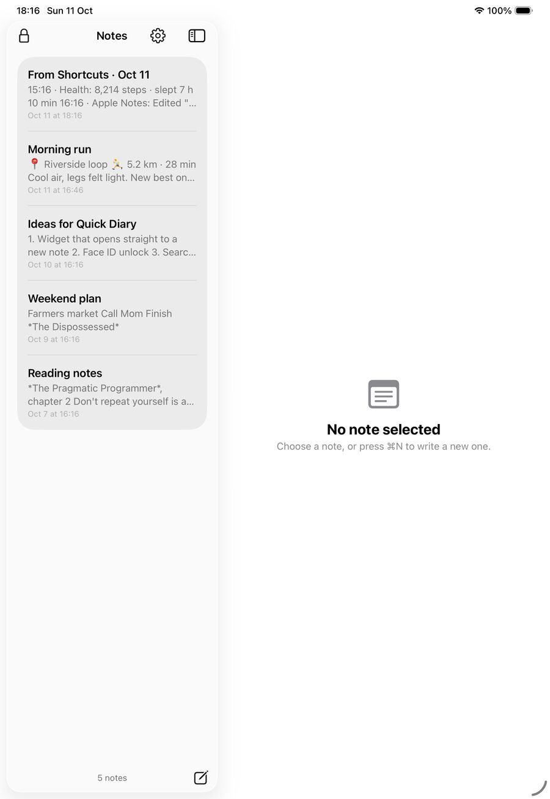 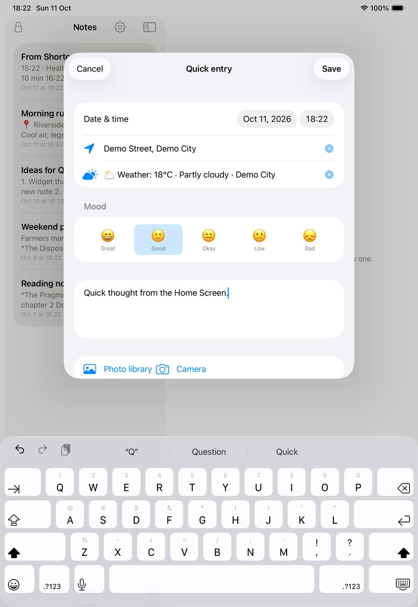</p>

The screenshots come from the UI test tour with demo data (`scripts/ci-test.sh`).

## Features

- **Markdown editor** with a preview (headings, lists, checkboxes, quotes, code, bold/italic/links).
- **Encrypted at rest.** Each note is a file `2026-10-03_1432.md.enc` (AES-256-GCM). The folder never holds plain text.
- **Choose where notes live** (Settings › Storage):
  - **On this iPhone** — Files › On My iPhone › Quick Diary
  - **iCloud Drive** — iCloud Drive › Quick Diary (needs a signed build, see below)
  - **Folder…** — any folder in Files, including shared iCloud Drive folders and other providers
- **Password + key.** A random 256-bit master key encrypts the notes. Your password unlocks the key file.
- **Change password** — only the key file is rewritten. Notes are not re-encrypted, so it's instant.
- **Recovery key** — shown once at setup, and again in Settings with your password. It can set a new password if you forget the old one, or if the key file is lost.
- **Key backup** — Settings › Back up key file exports `quick-diary-key.json`. It is still protected by your password.
- **One editor bar**, on top of the keyboard or at the bottom when the keyboard is hidden:
  - **Insert ▸** date & time, location, weather (Open-Meteo), Today…, photo library, camera, scan (document camera plus on-device text recognition)
  - **Format ▸** heading, list, checkbox, quote
  - your own quick-entry menus (Mood, Meal, Sport, or any list of options)
- **Home Screen quick actions** (touch and hold the app icon):
  - **Quick entry** — one sheet with date & time, place and weather (filled in for you), mood, text, voice dictation (on the iPhone when possible; audio is not saved) and up to 5 photos. Save makes one note.
  - **New note** — opens the editor.
- **Encrypted attachments** in `assets/`. Deleting a note keeps them. Settings › Attachments lists them largest first and deletes only after you confirm.
- **Face ID / Touch ID** unlock, **Lock after** 0 / 1 / 5 / 15 minutes, and a cover in the app switcher.
- **Shortcuts and Siri:**
  - **New Quick Diary entry**
  - **Add to Quick Diary.** It works while the app is locked: the text is encrypted at once with the vault's public key and shows in a "From Shortcuts" note after you unlock. Use it to bring in Apple Notes ("Find Notes"), Health ("Find Health Samples") or anything Shortcuts can read.
- **Today** (Insert ▸ Today…): the weather, reminders you completed, today's calendar and today's photos. Each permission is asked the first time you tap that section, and you pick what goes into the note.
- **AI**, Off by default:
  - Apple's on-device model (iOS 26, Apple Intelligence), or your own OpenAI-compatible server (OpenAI, OpenRouter, Ollama, llama.cpp, vLLM…) with the key in the Keychain.
  - Summarize a note, suggest a title, or summarize your day from Today.
  - Every answer is shown before it goes into a note, with how much text is sent and where.
- **Backup:**
  - S3 / R2 (SigV4). Only new and changed files are uploaded, and "Restore missing files" never replaces anything.
  - An encrypted **.zip** for Mail, Gmail, Files or AirDrop.
  - The storage provider sees only encrypted files, plus their names and sizes.
- **Photo strip** while editing: tap a thumbnail to view it, touch and hold to remove it from the note. The attachment itself stays.
- **Recently Deleted** keeps notes for 30 days.
- **Appearance** System / Light / Dark, applied at once.
- **Privacy page.** No servers, no accounts, no analytics. Weather sends a location rounded to about 1 km to Open-Meteo, only when you add the weather or open Quick entry.

## How the encryption works

```
Shortcuts (locked) ──X25519 + HKDF + AES-GCM──▶ inbox/*.qdin ──(private key, sealed by master key)──▶ note at unlock
password ──PBKDF2-SHA256 (600,000 rounds, random salt)──▶ key-encryption key
                                                           │ AES-256-GCM
master key (random 256-bit) ◀──────── quick-diary-key.json ┘
   │ AES-256-GCM
   ▼
2026-10-03_1432.md.enc   = "QDN1" + nonce + ciphertext + tag
```

- Changing the password re-wraps the master key with a new salt. Notes stay as they are.
- The recovery key is the master key, written as 16 groups of 4 hex digits. Anyone who has it can read the notes.
- The key file also stores a 16-byte check value (HMAC of the master key). It lets a recovery key be checked without the password.
- A folder is a whole vault: the key file sits next to the notes. To move the vault, copy the folder.
- Switching storage copies the key file and notes to the new place. Nothing is moved or deleted.

## Install on an iPhone

A free Apple ID is enough. It has these limits: the app must be re-signed every 7 days, the iPhone needs **Developer Mode** (Settings › Privacy & Security), iCloud Drive works only through **Folder…**, and Health works only through the Shortcuts bridge.

### With a Mac (terminal only)

[xtool](https://github.com/xtool-org/xtool) signs and installs from the command line:

```bash
scripts/build-ipa.sh
xtool auth login
xtool install --usb build/QuickDiary-unsigned.ipa
```

1. Build the IPA. It has no iCloud entitlement, because a free Apple ID cannot sign one.
2. Sign in with your Apple ID once. You type the password and the 2FA code yourself.
3. Connect the iPhone by USB, unlock it, and tap **Trust**. Then install.

On the first launch, trust your Apple ID in Settings › General › VPN & Device Management.

### Without a Mac

Every CI run uploads **QuickDiary-unsigned-ipa**:

```bash
gh run download -R jstdlee/quick-diary -n QuickDiary-unsigned-ipa
```

Sign and install it with [SideStore](https://sidestore.io), AltStore or Sideloadly.

## Build

Xcode only runs on macOS. From Linux, build on a Mac over SSH (`rsync` the repo, then run the scripts there) or use the GitHub Actions workflow.

The Xcode project is generated from `project.yml` with [XcodeGen](https://github.com/yonaskolb/XcodeGen):

```bash
brew install xcodegen
xcodegen generate
open QuickDiary.xcodeproj
```

### iCloud Drive

The iCloud option needs a device build signed by your Apple developer team. In Xcode, set the team and enable the iCloud capability (iCloud Documents, container `iCloud.com.jstdlee.quickdiary`). The entitlements are in `QuickDiary/QuickDiary.entitlements` and apply to device builds only.

Simulator and CI builds are unsigned, so they have no iCloud container. In those builds, **Folder…** still works with any iCloud Drive folder you pick in Files.

## Tests and screenshots

`scripts/ci-test.sh` (on macOS, and in CI on every push):

1. Generates the project.
2. Picks the newest iPhone and iPad simulators.
3. Runs the unit tests:
   - crypto: PBKDF2 known-answer vectors, wrong password, tampering, Unicode passwords, recovery key, password change
   - note store, Markdown parser
   - the app model's unlock, change-password and restore flow
4. Runs UI tests that walk through the app with demo data (editor bar, Insert and Format menus, Quick entry, Settings in dark mode…) and save screenshots to `screenshots/`.

The GitHub workflow uploads them as the **screenshots** artifact.

Launch flags for demos:

- `-demo` opens a seeded vault in a temp folder. The password is `demo1234`.
- `-demoFresh` opens an empty temp folder, which starts at "Create a password".
- `-quickEntry` (with `-demo`) opens the Quick entry sheet after unlock.

Both use fewer PBKDF2 rounds (20,000), so the tests stay fast. Real vaults use 600,000.
