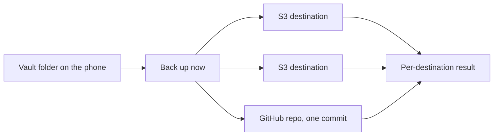

# Backup destinations

Encrypted copies of the phone's vault folder, to more than one S3-compatible bucket and more than one GitHub repo. The folder on the phone stays the vault you edit.

## Intent

Quick Diary already backs up to one S3 or R2 bucket. The owner wants the same encrypted files to land in S3-compatible storage and in a GitHub repo, and to more than one of each, without retyping the bucket they already set up.

The why, as decided: extra copies. Not a diary that lives only in a bucket or a repo. Opening, editing, and locking stay on the phone and keep working with no network.

## Goals

- A list of destinations. Each one is either S3-compatible (AWS S3, Cloudflare R2, MinIO, anything else that speaks SigV4 with path-style URLs) or a github.com repo.
- **Back up now** uploads the vault to every enabled destination. Only new and changed files. One destination failing does not undo or skip the others.
- **Restore missing files** asks which destination, then downloads files this vault does not already have. It never replaces or deletes a local file.
- The existing single S3 configuration becomes the first destination, secret included, so it does not have to be typed again.
- A public GitHub repo is refused. Nothing is uploaded to it.
- The copy includes the whole vault folder, including `quick-diary-key.json`. That file stays locked by the password.
- The .zip share stays as it is.

## Non-goals

- The bucket or the repo is not where notes live. The phone is not a cache.
- No scheduled or automatic backup. The owner taps Back up now.
- No deleting remote files when a note is deleted on the phone. A backup that forgets is not a backup. Old ciphertext stays until the owner removes it in the bucket or on GitHub.
- No creating the GitHub repo, the branch, or the S3 bucket. If it is missing, that destination fails with a plain error.
- No GitHub Enterprise, no Gitea, no GitHub OAuth.
- No second encryption. Files are already encrypted on the phone. The remote side sees names and sizes.
- No change to Storage (On this iPhone, iCloud Drive, Folder…).

## Constraints

- iOS 17, SwiftUI, the existing `ObjectStore` (`list`, `put`, `get`). Tests use `MemoryStore` and the existing `StubProtocol`. No network in tests.
- Secrets stay in the Keychain (`Secrets`), never in UserDefaults and never in the vault.
- Demo mode and the UI test that taps `backupNow` must still back up with no credentials typed.
- Sideloaded app, no server. GitHub auth is a fine-grained personal access token the owner pastes.

## Decisions

Theirs, from the request and from the round they submitted:

- S3-compatible storage and a GitHub repo are both places the encrypted files can go.
- More than one destination, mixed.
- Backup copies of the folder on the phone, not a live remote vault.
- Fine-grained personal access token, in the Keychain.
- github.com only.
- Refuse a public repo.
- Migrate the saved S3 settings into the first destination.
- Include the key file.
- No extra failure condition beyond those.

Calls made here, not by them:

- Destinations run one after another, not in parallel. Progress names the destination, then the file count.
- A GitHub backup is one commit on the chosen branch per successful run (`Backup Quick Diary`), built with the Git Data API (blobs, tree, commit, update ref). Not one commit per file, and not a clone of a git working tree on the phone.
- Unchanged detection stays per file. `ObjectStore` grows `fingerprint(_:)`. S3 and `MemoryStore` keep MD5 hex, which is what an S3 single-part ETag already is. GitHub uses the git blob id, SHA-1 of `blob <size>\0<bytes>`, which the Trees API returns, so unchanged files are not uploaded again.
- A file of 95 MB or larger is not sent to GitHub. That destination still commits the rest, and its result says how many files were too large. S3 is unchanged and has no such cap in the app.
- The branch field defaults to the repo's default branch when left blank. If that ref does not exist, the destination fails and tells the owner to create the repo and branch on GitHub first.
- Folder prefix defaults to `quick-diary` for both kinds, same as today.
- Restore with one destination skips the picker. With several, the owner picks one, then confirms. Same rule as today: nothing local is replaced or deleted.
- Deleting a destination removes its Keychain secret and the row. It does not delete remote objects.
- Demo mode: **Back up now** writes to one in-memory store and does not need a saved destination, so the existing screenshot test keeps working.

## Model

```text
BackupDestination
  id            UUID
  name          owner-chosen; migration uses the bucket name
  enabled       Bool
  kind          s3 | github
  s3            endpoint, region, bucket, prefix, accessKeyID
  github        owner, repo, branch, prefix
  lastBackup    Date?
  lastError     String?
```

The secret (S3 secret key, or the GitHub token) is Keychain account `backup-secret-<id>`. UserDefaults key `backupDestinations` holds the JSON array. `BackupConfig` / `backupConfig` and `Secrets.s3Secret` are read once, copied onto the new destination, then removed.

A destination is runnable when it is enabled and its fields and secret are present. **Back up now** is disabled when none are runnable and the app is not in demo mode.

`GitHubStore` talks only to `https://api.github.com`:

1. `GET /repos/{owner}/{repo}`. Missing repo: fail. `"private": false`: fail before any upload, "This repo is public. Quick Diary will not upload to it."
2. `GET /repos/{owner}/{repo}` also supplies the default branch when the branch field is blank.
3. `GET /repos/{owner}/{repo}/git/ref/heads/{branch}`, then `GET /repos/{owner}/{repo}/git/trees/{sha}?recursive=1`. Tree entries whose path starts with the prefix map to fingerprint = blob sha.
4. For each changed file under 95 MB: `POST /repos/{owner}/{repo}/git/blobs` with base64 content.
5. `POST /repos/{owner}/{repo}/git/trees` with `base_tree` and only the changed paths (`mode` `100644`, type `blob`).
6. `POST /repos/{owner}/{repo}/git/commits`, parent = the branch tip, message `Backup Quick Diary`.
7. `PATCH /repos/{owner}/{repo}/git/refs/heads/{branch}` to the new commit.

`get` for restore uses `GET /repos/{owner}/{repo}/contents/{path}?ref={branch}` and decodes base64. List for restore uses the same recursive tree. Authorization is `Bearer <token>`. Accept `application/vnd.github+json`.

Token needs contents read and write on that repo. The app does not request a scope list; a 403 says to check the token and that the repo is private.



## What the owner sees

Settings › Backup stays one Form, same rows and footer tone as the screen today.

- **Destinations.** One row per destination: name, kind, and a short last result (time, or the error in red). Tap to edit. Swipe to delete, with a confirmation. **Add destination** pushes an editor whose first control is S3 or GitHub.
- S3 editor: name, endpoint, region, bucket, folder, access key id, secret. Same placeholders as today.
- GitHub editor: name, owner, repo, branch, folder, token. Footer: fine-grained token, contents on this private repo, github.com only. The token field is a secure field.
- **Back up now.** Runs every runnable destination. Progress reads `Name: 3 of 20 files`, then the next destination. Afterwards one line per destination: uploaded, unchanged, too large for GitHub, or the error. A green line only when every destination succeeded; otherwise the failures are red and the successes stay listed.
- **Restore missing files.** Picks a destination when there is more than one, then the same confirmation as today.
- **Other backups.** The .zip section is unchanged.

Help, Privacy, and the README backup lines mention more than one S3-compatible destination and a private GitHub repo. They say the phone folder is still the vault, and that a public repo is refused.

## Tests

Unit tests, no network:

- Existing S3 and backup tests still pass. `fingerprint` on `MemoryStore` and `S3Store` is MD5, so unchanged detection does not change.
- Two memory destinations: the first `put` throws, the second still receives the files. The combined result has one error and one summary.
- Loading destinations when only the old `backupConfig` and `Secrets.s3Secret` exist produces one enabled S3 destination with those fields, and the old keys are gone.
- A stubbed `GET /repos/...` with `"private": false` throws the public-repo error and performs no blob or commit request.
- A stubbed tree whose blob sha equals `fingerprint(data)` uploads nothing. A changed file produces one blob, one tree, one commit, one ref update.
- A file of 95 MB or more is absent from the tree post, and the summary counts it skipped.
- Restore from destination A does not read destination B.

The UI test `backupNow` tap still finds the button and finishes in demo mode.

## Left to the builder

- Line breaks and the exact system images, as long as the rows above are there and match the existing Form.
- The wording of errors, as long as a missing repo, a public repo, a bad token, and a too-large GitHub file are distinguishable.
- How the in-memory demo store is keyed, as long as demo backup and the screenshot test need no credentials.

## Artifacts

- Round 1, document `backup-destinations`, page `http://localhost:27319/document/RJZwDIrbn0ml6afP1v6eh`. Submitted: copies, pat, dotcom, refuse, migrate, include. The failure question was submitted with no text; no extra constraint.
- This file is the build source: `docs/ryugi/specs/2026-11-20-backup-destinations-design.md`.
